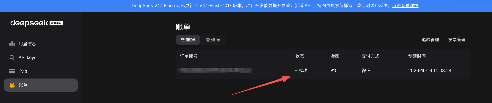

## 一、安装uv后运行`uv -V`报错

通过终端运行`curl -LsSf https://astral.sh/uv/install.sh | sh`安装uv，查询uv是否安装成功运行`uv -V`后报错`To add $HOME/.local/bin to your PATH, either restart your shell or run...`

```js
downloading uv 0.13.1 x86_64-apple-darwin
installing to /Users/xiu/.local/bin
  uv
  uvx
everything's installed!

To add $HOME/.local/bin to your PATH, either restart your shell or run:

    source $HOME/.local/bin/env (sh, bash, zsh)
    source $HOME/.local/bin/env.fish (fish)
```

意味着 `‌uv‌` 已经成功安装到了 `$HOME/.local/bin` 目录，但该目录尚未包含在你的系统 `PATH` 环境变量中，因此你暂时无法直接在终端输入 `uv` 来运行它。

你需要根据你使用的 Shell 类型，执行以下操作之一来让 uv 命令立即生效：

### 1. 临时生效（当前终端窗口）

#### 1-1 如果你使用的是 ‌bash‌、‌zsh‌ 或 ‌sh‌，请在终端中直接运行

```js
source $HOME/.local/bin/env
```

#### 1-2 如果你使用的是 ‌fish‌ shell，请运行

```js
source $HOME/.local/bin/env.fish
```

运行后，你可以输入 `uv --version` 验证是否成功。注意：这种方式只在当前打开的终端窗口有效，关闭窗口后需重新执行。

### 2. 永久生效（推荐）

为了避免每次打开新终端都要手动执行上述命令，建议将路径添加到你的 Shell 配置文件中。

#### 2-1 对于 Bash / Zsh 用户

##### 2-1-1 打开你的配置文件（通常是 ~/.bashrc 或 ~/.zshrc）

```js
// 如果是 zsh (macOS 默认)
nano ~/.zshrc

// 如果是 bash (Linux 常见)
nano ~/.bashrc
```

##### 2-1-2 在文件末尾添加以下行

```js
export PATH="$HOME/.local/bin:$PATH"
```

##### 2-1-3 保存并退出编辑器，然后运行以下命令使配置立即生效

```js
source ~/.zshrc
// 或 source ~/.bashrc
```

#### 2-2 对于 Fish 用户

##### 2-2-1 编辑 Fish 配置文件

```js
nano ~/.config/fish/config.fish
```

##### 2-2-2 添加以下行

```js
fish_add_path $HOME/.local/bin
```

##### 2-2-3 保存并重启终端或运行

```js
source ~/.config/fish/config.fish
```

### 3. 验证安装

配置完成后，在任意新打开的终端中输入

```js
uv --version
```

如果输出了版本号（例如 `uv 0.x.x`），则说明配置成功。

## 二、运行pip install openai报错zsh: command not found: pip

正在使用 uv，这个问题可能有两种场景：一是在‌系统全局环境‌中找不到 pip，二是在 ‌uv 创建的虚拟环境‌中找不到 pip。请根据你的实际情况选择对应的解决方案。

在系统全局环境中报错（最常见）
如果你没有在激活任何虚拟环境，直接在终端输入 pip 报错，请按以下步骤排查：

1. 尝试使用 pip3
Python 3 的包管理器默认命令通常是 pip3 而不是 pip。运行

```js
pip3 install openai
```

## 三、运行运行pip install openai报错

```js
ERROR: Could not find a version that satisfies the requirement jiter<1,>=0.10.0 (from openai) (from versions: 0.1.0, 0.4.0, 0.4.1, 0.4.2, 0.5.0, 0.6.0, 0.6.1, 0.7.0, 0.7.1, 0.8.0, 0.8.2, 0.9.0, 0.9.1)
ERROR: No matching distribution found for jiter<1,>=0.10.0 (from openai)
WARNING: You are using pip version 19.2.3, however version 25.0.1 is available.
You should consider upgrading via the 'pip install --upgrade pip' command.
```

这个错误的核心原因非常明确：‌你的 pip 版本过旧（19.2.3），导致它无法识别或下载较新的依赖包 jiter（需要 >=0.10.0 版本）。‌

从报错信息可以看出，你当前的 pip 只能看到 jiter 的旧版本（最高到 0.9.1），而 openai 库要求至少 0.10.0 版本。同时，系统也明确提示你有新版 pip (25.0.1) 可用。

请按照以下步骤解决：

### 第一步：升级 pip（最关键步骤）

由于你当前的 pip 版本太老，直接运行 pip install --upgrade pip 可能会因为文件占用或权限问题失败。‌最稳妥的方式是通过 Python 解释器来调用 pip进行自我升级。‌

#### 3-1 请在终端中执行以下命令

```js
python -m pip install --upgrade pip
```

#### 3-2 ‌如果是 macOS/Linux‌ 且遇到权限错误，请尝试

```js
python -m pip install --upgrade pip --user
// 或者
sudo python -m pip install --upgrade pip
```

#### 3-3 如果是 Windows‌ 且遇到权限错误

请以‌管理员身份‌运行 CMD 或 PowerShell，然后执行上述命令

**注意‌**：如果你系统中同时安装了 `Python2` 和 `Python3`，请确保使用 `python3` 而不是 `python`，即执行

```js
python3 -m pip install --upgrade pip
```

#### 3-4 验证 pip 版本

升级完成后，检查 pip 版本是否已更新到最新版（或至少高于 21.x）

```js
pip --version
```

你应该看到类似 `pip 25.0.1 from ...` 的输出，而不是之前的 `19.2.3`。

#### 3-5 重新安装 openai

pip 升级成功后，再次尝试安装 openai 库，此时它应该能正确识别并下载 jiter >= 0.10.0：

```js
pip install openai
```

## 四、运行python文件报错

```js
Traceback (most recent call last):
  File "/Users/xiu/Documents/personal/python-demo/src/python_demo/llmdemo.py", line 22, in <module>
    response = client.chat.completions.create(
        model="deepseek-v4-pro",
    ...<3 lines>...
        ]
    )
  File "/Library/Frameworks/Python.framework/Versions/3.15/lib/python3.15/site-packages/openai/_utils/_utils.py", line 298, in wrapper
    return func(*args, **kwargs)
  File "/Library/Frameworks/Python.framework/Versions/3.15/lib/python3.15/site-packages/openai/resources/chat/completions/completions.py", line 1318, in create
    return self._post(
           ~~~~~~~~~~^
        "/chat/completions",
        ^^^^^^^^^^^^^^^^^^^^
    ...<53 lines>...
        stream_cls=Stream[ChatCompletionChunk],
        ^^^^^^^^^^^^^^^^^^^^^^^^^^^^^^^^^^^^^^^
    )
    ^
  File "/Library/Frameworks/Python.framework/Versions/3.15/lib/python3.15/site-packages/openai/_base_client.py", line 1440, in post
    return cast(ResponseT, self.request(cast_to, opts, stream=stream, stream_cls=stream_cls))
                           ~~~~~~~~~~~~^^^^^^^^^^^^^^^^^^^^^^^^^^^^^^^^^^^^^^^^^^^^^^^^^^^^^
  File "/Library/Frameworks/Python.framework/Versions/3.15/lib/python3.15/site-packages/openai/_base_client.py", line 1213, in request
    raise self._make_status_error_from_response(err.response) from None
openai.APIStatusError: Error code: 402 - {'error': {'message': 'Insufficient Balance (request_id: a0929477-bb15-48f9-b915-75a82ced944d)', 'type': 'unknown_error', 'param': None, 'code': 'invalid_request_error'}}
```

‌问题原因‌：API 账户余额耗尽或额度用尽。
‌核心操作‌：登录 API 提供商后台 -> 检查余额 -> 充值或调整预算限制。


