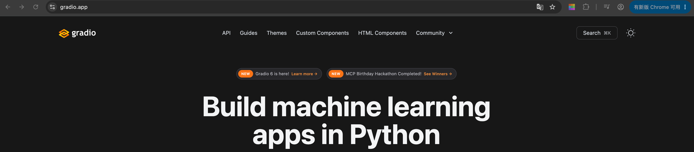
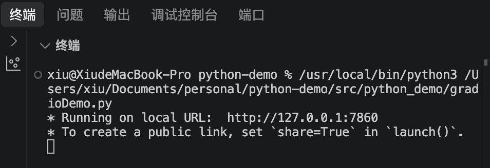
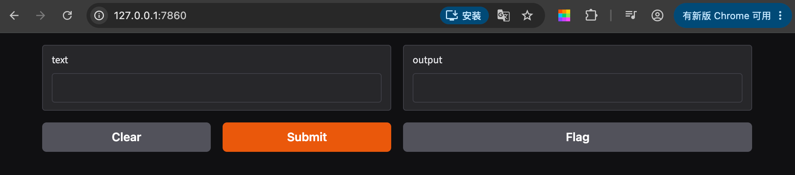
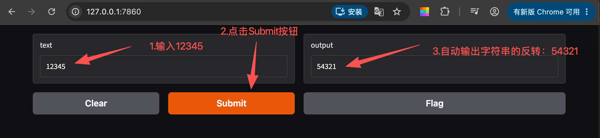
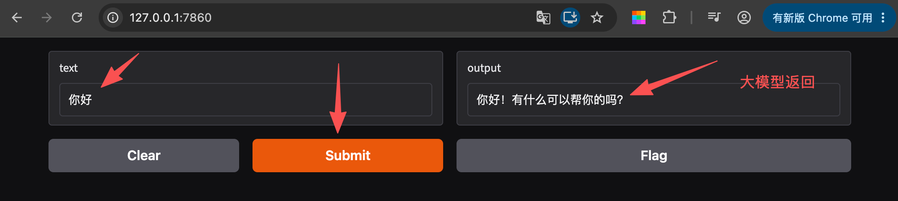

## 一、什么是Gradio

Gradio是一款基于Python的轻量级Web UI框架，转为机器学习、大模型应用快速构建可交互的演示Demo而生。

- 仅需少量Python代码即可生成完整Web界面
- 原生支持文本、数字、图片、音频、文件等多种交互组件
- 适配模型验证、功能测试、效果演示等多种场景

[Gradio官网](https://gradio.app/)



## 二、为什么学习Gradio

### 2-1 直观的可视化验证

将纯代码逻辑转化为图形化交互界面，直观展示模型、API、函数的运行效果；相比控制台输出，调试与演示效率大幅提升。

### 2-2 快速部署与分享

1. 本地一键启动服务，默认占用7860端口，浏览器即可访问

2. 内置`share=True`参数：通过反向代理机制生成临时公共URL，有效期72小时

3. 无需购买域名、无需备案，即可快速将Demo分享给他人体验

### 2-3 极低的学习成本

1. 核心基础代码仅4行左右，Python开发者可快速上手

2. 无需掌握HTML、CSS等前端技术，开发者可专注于大模型核心业务逻辑

## 三、Gradio核心基础用法

导入库：`import gradio as gr`

定义业务函数：编写需要演示的核心功能逻辑

实例化界面：通过`gr.Interface()`绑定函数与输入输出组件

启动服务：调用`.launch()`运行Web服务

```python
import gradio as gr

def greet(name, intensity):
    return "Hello, " + name + "!" * int(intensity)

demo = gr.Interface(
    fn=greet,
    inputs=["text", "slider"],
    outputs=["text"],
    api_name="predict"
)

demo.launch()
```

## 四、实例

### 4-1 安装gradio

```js
pip install gradio
```

### 4-2 新建gradioDemo.py文件

#### 4-2-1 实现输入字符串，输出反转的字符串功能

```python
# 1. 导入Gradio库
import gradio as gr

# 2. 定义业务函数：字符串反转
def reverse_text(text):
    return text[::-1]

# 3. 实例化界面，绑定函数与组件
demo = gr.Interface(
    fn=reverse_text, # 核心功能函数
    inputs=["text"], # 输入组件：文本输入框
    outputs=["text"], # 输出组件：文本输出框
    api_name="reverse_text_demo"
)

# 4. 启动服务
demo.launch()
```

选中`gradioDemo.py`文件，鼠标右键选择`Run Python File in Terminal`，控制台就会输出运行结果



在浏览器中打开 `http://127.0.0.1:7860`



在输入框中输入12345，点击Submit按钮，输出框自动输出54321



#### 4-2-2 进阶：调用大模型，实现基本对话功能

##### 第一步：将调用大模型封装成一个函数

```python
import os
from openai import OpenAI 
from dotenv import load_dotenv
# 加载.env文件的  DEEPSEEK_API_KEY="你申请的sk-xxx"
load_dotenv()

# 入参含义  text: 用户的输入
# 将调用大模型封装成一个方法
def get_completion(text):
    # os.getenv 从当前项目的.env文件中获取DEEPSEEK_API_KEY
    client = OpenAI(
        api_key=os.getenv('DEEPSEEK_API_KEY'),
        base_url="https://api.deepseek.com",
    )
    response = client.chat.completions.create(
        model="deepseek-v4-pro",
        messages=[
            # {"role": "system", "content": "You are a helpful assistant"},
            {"role": "user", "content": text},
        ],
        stream=False,
        reasoning_effort="hign",
        extra_body={"thinking": {"type": "enabled"}}
    )
    return response.choices[0].message.content
```

##### 第二步：定义业务函数时返回大模型方法的结果

```python
# 2. 定义业务函数：字符串反转
def reverse_text(text):
    # return text[::-1]
    # 改为调用封装的大模型方法
    return get_completion(text)
```

新建`demo.py`，最终代码为

```python
import os
# 1. 导入Gradio库
import gradio as gr
from openai import OpenAI
from dotenv import load_dotenv
# 加载.env文件的  DEEPSEEK_API_KEY="你申请的sk-xxx"
load_dotenv()

# 入参含义  text: 用户的输入
# 将调用大模型封装成一个方法
def get_completion(text):
   # os.getenv 从当前项目的.env文件中获取DEEPSEEK_API_KEY
   client = OpenAI(
      api_key=os.getenv('DEEPSEEK_API_KEY'),
      base_url="https://api.deepseek.com",
   )

   response = client.chat.completions.create(
      model="deepseek-v4-pro",
      messages=[
         # {"role": "system", "content": "You are a helpful assistant"},
         {"role": "user", "content": text},
      ],
      stream=False,
      reasoning_effort="high",
      extra_body={"thinking": {"type": "enabled"}}
   )
   # print(response.choices[0].message.content)
   return response.choices[0].message.content

# 2. 定义业务函数
def reverse_text(text):
   # 字符串反转
   # return text[::-1]
   # 改为调用封装的大模型方法
   return get_completion(text)

# 3. 实例化界面，绑定函数与组件
demo = gr.Interface(
   fn=reverse_text, # 核心功能函数
   inputs=["text"], # 输入组件：文本输入框
   outputs=["text"], # 输出组件：文本输出框
   api_name="reverse_text_demo"
)

# 4. 启动服务
demo.launch()
```

选中`demo.py`文件，鼠标右键选择`Run Python File in Terminal`，控制台就会输出运行结果

**注意**：之前运行的控制台一定要关闭，不然7860端口被占用，会报错。

在浏览器中打开 `http://127.0.0.1:7860`

输入你好，点击Submit，返回大模型返回的结果


