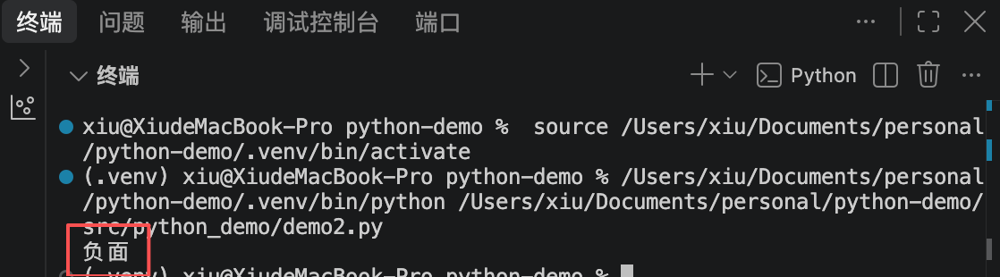
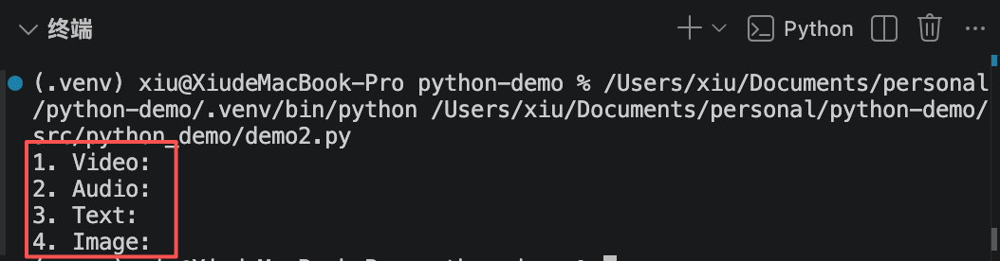
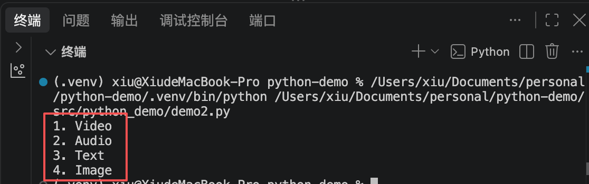
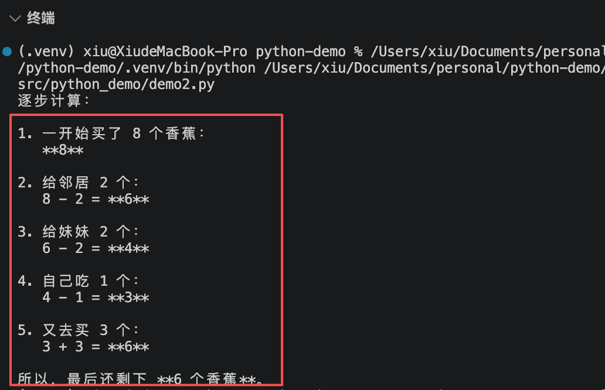
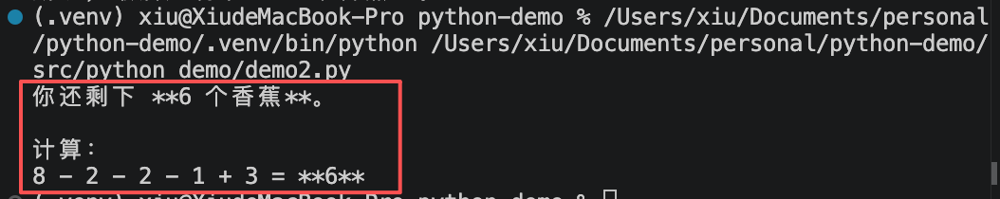

## 一、零样本与少样本提示

### 1-1 Zero-Shot（零样本）

模型直接根据指令执行任务，无需任何示例。适用于指令遵循能力强的预训练模型，输出稳定性高度依赖**温度设置**。

- 0.0-0.2 事实类/推理类：高稳定性，输出稳定
- 0.3-0.7 通用任务：兼顾准确度与表达多样性
- 0.8-1.0 创意任务：强随机性，激发模型联想力

### 1-2 Few-Shot（少样本）

通过提供1-10个”输入-输出“示例，激活模型的上下文学习（In-context Learning）机制，使其学习特定的模式。

- 规范格式：强制模型学习特定的JSON或文件输出结构。
- 对齐风格：模仿特定的语气、术语习惯或翻译风格。
- 示例数量：1个示例是起步，复杂任务建议3-5个示例。

### 1-3 代码示例

#### 1-3-1 零样本情感分类代码示例

```python
import os
from openai import OpenAI
from dotenv import load_dotenv
# 加载.env文件的  DEEPSEEK_API_KEY="你申请的sk-xxx"
load_dotenv()

deepseek_api_key = os.getenv('DEEPSEEK_API_KEY')
# os.getenv 从当前项目的.env文件中获取API key
client = OpenAI(
    api_key=deepseek_api_key,
    base_url="https://api.deepseek.com",
)

# 零样本情感分类
prompt = """
将文本分类为中性、负面或正面。
文本：我认为这次假期人太多。
情感：
"""

# 打印提示词
# print(prompt)

def get_completion(prompt, model="deepseek-v4-pro"):
    messages=[{"role": "user", "content": prompt}]
    response = client.chat.completions.create(
        model=model,
        messages=messages,
        temperature=0, # 模型输出的随机性，0表示随机性最小
    )
    # 打印返回值
    # print(response)
    return response.choices[0].message.content
# 打印最终输出结果
print(get_completion(prompt))
```

控制台输出结果



#### 1-3-2 少样本代码示例

将提示词改为

```python
# 少样本
prompt = """
1.视频：这是一段对于视频的描述。
2.音频：这是一段对于音频的描述。
3.文本：这是一段对于文本的描述。
4.图片：这是一段对于图片的描述。

请把上面4段话各自的开头几个词，翻译成英文，并按序号输出。
"""
```

控制台输出的结果带`：`



想要去掉`：`，在提示词中加上”例如，第一段话的开头是"视频"，那么就输出"Video"“这段话即可

```python
# 少样本
prompt = """
1.视频：这是一段对于视频的描述。
2.音频：这是一段对于音频的描述。
3.文本：这是一段对于文本的描述。
4.图片：这是一段对于图片的描述。

请把上面4段话各自的开头几个词，翻译成英文，并按序号输出。例如，第一段话的开头是"视频"，那么就输出"Video"
"""
```



## 二、思维链（CoT）

思维链 Chain of Tought

通过中间推理步骤引导模型，将复杂问题拆解为线性逻辑序列，显著提升逻辑、数学与常识推理能力。

- 显示推理：将求解过程展示给模型，启用上下文学习（Few-shot CoT）。
- 零样本引导：利用”让我们逐步思考“激发模型原生推理潜力（Zero-shot CoT）。
- 适用场景：需要中间计算或多环节判断的确定性任务。

### 2-1 示例

修改提示词

```python
# 零样本COT提示
prompt = """
我去市场买了8个香蕉，我给了邻居2个香蕉，又给了妹妹2个香蕉。
然后我自己吃了一个香蕉又去买了3个香蕉。我还剩下几个香蕉？让我们逐步思考
"""
```

控制台输出结果



将"让我们逐步思考"这句话去掉后

```python
# 零样本COT提示
prompt = """
我去市场买了8个香蕉，我给了邻居2个香蕉，又给了妹妹2个香蕉。
然后我自己吃了一个香蕉又去买了3个香蕉。我还剩下几个香蕉？
"""
```

控制台输出结果


