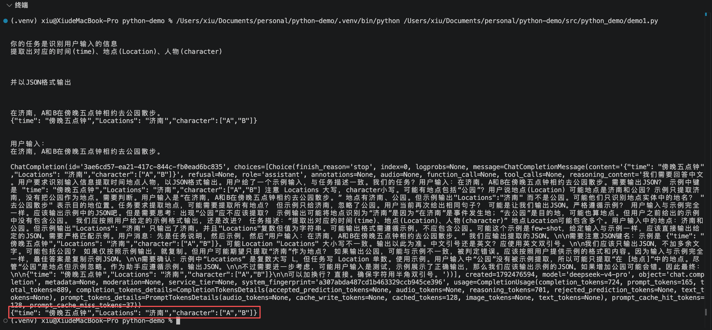

## 用代码完成提示工程

### 从对话到工程化集成

#### 工程化思想

不再是随性的聊天，而是通过结构化模版定义输入输出，确保结果的确定性。

#### API联动

通过OpenAI兼容接口调用大模型，将AI能力无缝嵌入业务代码流程。

#### 数据闭环

自动处理用户输入，拼接预设指令，并对输出进行结构化解析（如JSON）。

### 完整代码示例

```python
# Please install OpenAI SDK first: `pip3 install openai`
import os
# python3 -m pip install python-dotenv 或 python -m pip install python-dotenv 或 pip install openai 或 pip3 install openai
from openai import OpenAI
# python3 -m pip install python-dotenv 或 python -m pip install python-dotenv 或 pip install python-dotenv  或  pip3 install python-dotenv
from dotenv import load_dotenv
# 加载.env文件的  DEEPSEEK_API_KEY="你申请的sk-xxx"
load_dotenv()

deepseek_api_key = os.getenv('DEEPSEEK_API_KEY')
# os.getenv 从当前项目的.env文件中获取API key
client = OpenAI(
    api_key=deepseek_api_key,
    base_url="https://api.deepseek.com",
)

input_text = "在济南，A和B在傍晚五点钟相约去公园散步。"

"""对任务进行描述"""
instruction = """
你的任务是识别用户输入的信息
提取出对应的时间(time)、地点(Location)、人物(character)
"""

"""输出"""
output = """
并以JSON格式输出
"""

"""例子"""

# example = """
# 十一假期，爸妈和我一起去三亚海边度假。
# {"时间": "十一假期","地点": "三亚海边","人物":["爸妈","我"]}
# """

example = """
在济南，A和B在傍晚五点钟相约去公园散步。
{"time": "傍晚五点钟","Locations": "济南","character":["A","B"]}
"""

prompt = f"""
{instruction}

{output}

{example}

用户输入：
{input_text}
"""

# 打印提示词
print(prompt)

def get_completion(prompt, model="deepseek-v4-pro"):
    messages=[{"role": "user", "content": prompt}]
    response = client.chat.completions.create(
        model=model,
        messages=messages,
        temperature=0, # 模型输出的随机性，0表示随机性最小
    )
    # 打印返回值
    print(response)
    return response.choices[0].message.content
# 打印最终输出结果
print(get_completion(prompt))
```

运行上面代码，控制台输出结果


