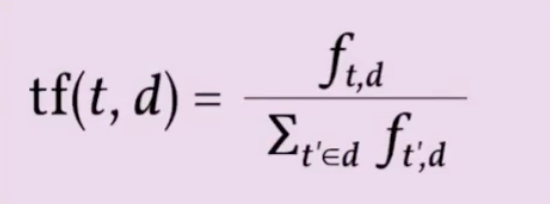
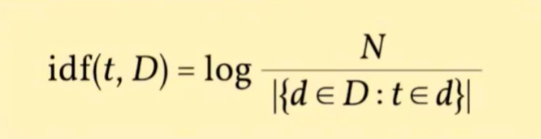

## 一、RAG文本向量化是什么

RAG技术与文本向量化的作用

向量化是RAG流程中“**索引**”阶段的关键环节。

它将处理后的文本或其他类型的信息转换为带有语义的向量，直接决定了：**检索的准确性**、**生成的质量**。

### 1-1 RAG中索引层的本质：语义空间的桥梁

#### 1-1-1 索引层的任务

索引层是连接**原始知识**和**语义检索**的桥梁。其核心任务是将文本通过Embedding Model转换为高维向量表示。

文本 → Embedding Model → 高维向量（通常在768-1024维）

#### 1-1-2 向量空间特性

- 同类别：高相似度（d=0.1）
- 不同类别：低相似度（d=0.8）
- 文本与图像：语义对齐

示例说明：狗（动物类）、汽车（交通工具类） → 类别差异大、距离远

#### 1-1-3 语义即距离

在向量空间中，**语义相近的文本**在几何空间中的**欧氏距离**或**余弦距离**更近。这种几何特性使得语义检索成为可能。

##### 1-1-3-1 余弦距离

- 余弦相似度的取值范围从`-1`到`1`
- `1`表示两个向量完全相同，越接近`1`的值则表明向量之间的相似度越高
- `0`表示它们正交，没有相关性
- `-1`表示两个向量完全相反

对两个二维向量a=(a1,a2)，b=(b1,b2)余弦相似度的计算公式为

$$
余弦相似度 = \frac{a1b1+a2b2}{\sqrt{a1^{2}+a2^{2}} * \sqrt{b1^{2}+b2^{2}}}
$$

## 二、语义权重增强是如何实现的

语义权重增强如何提升检索能力

### 2-1 TF-IDF优化对比

Term Frequency（TF）词频：表示词条在文本中出现的频率，一般是词频除以文章总词数

Inverse Document Frequency（IDF）逆文件频率：表示关键词的普遍程度。如果包含词条i的文档越少，IDF越大

#### 2-1-1 普通向量化

处理方式：将“**新能源汽车销量预测-比亚迪**”整体进行平均编码，所有词语权重相同。

❌ 可能召回“特斯拉销量预测”等非目标实体
❌ 噪声大，精确率较低
❌ 无法区分关键实体与背景词汇

精确率表现**基准水平**。

#### 2-1-2 语义权重增强（TF-IDF）

处理方式：识别并增加“**比亚迪**“、”**2026**“等关键实体的向量权重。

✅ 实体匹配更精准
✅ 显著降低噪声干扰
✅ 提升检索结果相关性

精确率提升**12%**

## 三、维度的最优平衡

根据业务场景精准度要求选择维度

### 3-1 Base维度 768维度

通用基础场景

适用场景：通用回答、知识库检索、常规文档搜索

💚性价比高：存储与计算成本适中
💚语义区分度提升：较512维提升10%

推荐场景：**通用业务场景首选**

### 3-2 Large维度 1024维度

高精准场景

适用场景：法律文书、医疗诊断、金融合规、技术专利

🧡距离差扩大：相似与非相似文档距离差扩大30%
🧡误检率大幅降低：高精度场景下的最佳选择

推荐场景：**高精度专业场景**

## 四、实战应用与展望

跨模态与混合检索的业务落地场景

### 4-1 剪辑：跨模态检索

视频、音频、文本统一空间

核心能力：将视频帧、音频、脚本映射到同一向量空间。

应用示例：搜索“猫咪搞笑” → 召回：猫咪画面 + 搞笑背景音乐

✅视频内容理解
✅音频语义匹配
✅文本描述关联

应用场景：短视频内容检索与推荐

### 4-2 金融：混合检索

关键词 + 语义向量融合

核心方案：关键词检索 + 语义向量 = 加权融合

融合权重：比如 关键词（0.6）：语义向量（0.4）

解决问题：专有名词（如“小店入驻”）检索不准的问题

应用场景：金融合规文档检索
