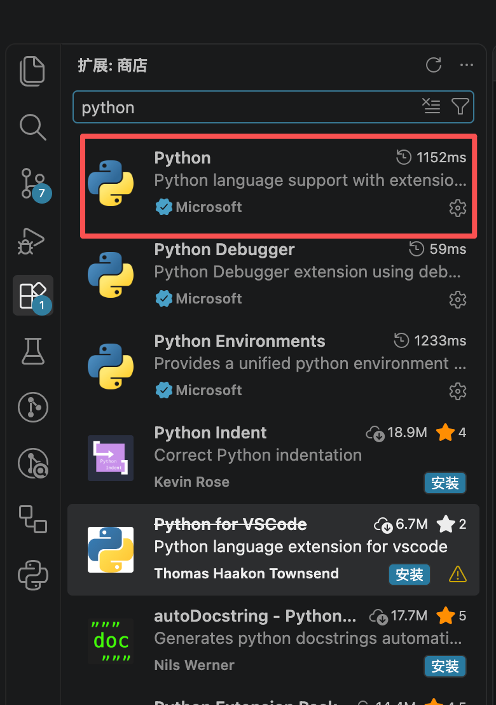
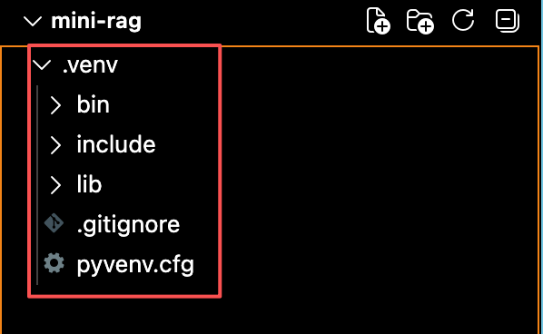
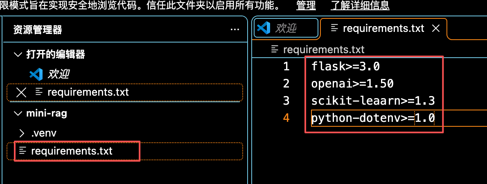
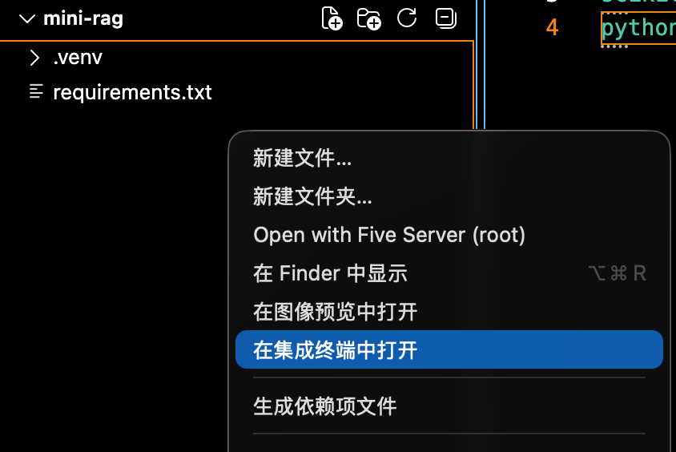
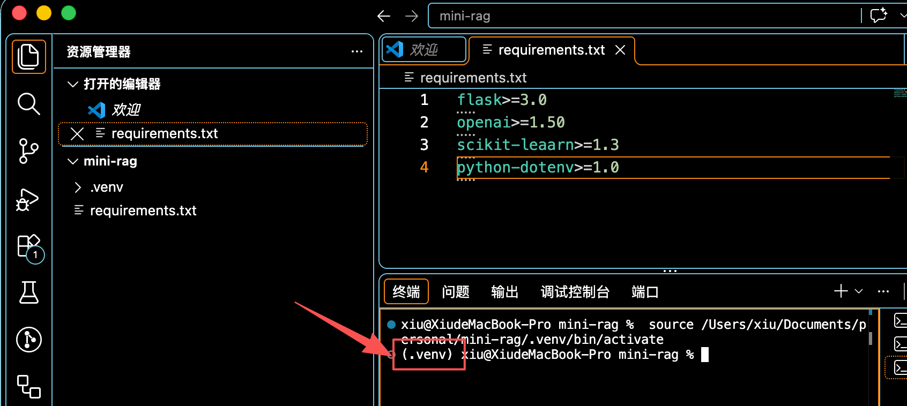

## 一、创建项目与基础配置

### 1-1 新建文件夹（mini-rag）

首先，创建一个空的文件夹`mini-rag`，用VSCode打开。

### 1-2 安装Python环境

**详细python安装可查看我的《通过调用API使用大模型》文章**

在 macOS 上配置 VS Code 的 Python 环境，可以按下面步骤操作：

1-1-1 安装 Python 3，并在 VS Code 扩展中安装 Microsoft 的 **Python** 扩展。

要确认配置是否生效，可在终端运行 `python3 --version` 和 `which python3`



1-2-2 打开 `mini-rag`（Python）项目目录，在终端运行以下命令创建虚拟环境

```bash
python3 -m venv .venv
```

运行完代码后，会自动创建`.venv`文件夹，文件夹内包含以下目录



<!-- 1-2-3 按 `Cmd+Shift+P`，运行 **Python: Select Interpreter**，选择项目里的 `.venv`。通常路径是 `.venv/bin/python`。 -->

### 1-3 安装依赖

在`mini-rag`项目中新建`requirements.txt`文件，文件中写入需要安装的依赖及版本号

```txt
flask>=3.0
openai>=1.50
scikit-learn>=1.3
python-dotenv>=1.0
```



|依赖|作用|
|----|----|
|`flask`|Web框架，路由+静态文件托管+SSE|
|`openai`|调用DeepSeek API（兼容OpenAI协议）|
|`scikit-learn`|TF-IDF文件向量化，零模型下载、纯CPU|
|`python-dotenv`|从`.env`文件读取API Key等配置|

   如果项目没有 `requirements.txt`，可按项目实际需要安装依赖。

也可以在项目的 `.vscode/settings.json` 中设置默认解释器：

```json
{
  "python.defaultInterpreterPath": "${workspaceFolder}/.venv/bin/python"
}
```

在`mini-rag`项目中右键选择`在集成终端中打开`



等待VS Code终端跳转到虚拟环境



如果 VS Code 终端没有自动激活虚拟环境，运行 **Python: Create Terminal**，或手动执行 `source .venv/bin/activate`。

安装：

```cmd
pip install -r requirements.txt
```

安装如果网络不好，后面可以加镜像网站

```cmd
pip install -r requirements.txt -i https://pypi.tuna.tsinghua.edu.cn/simple/
```

### 1-4 配置API Key

创建`.env.example`模板(这里使用的是deepseek，所以这里配置的请求地址是deepseek的地址)

```python
DEEPSEEK_BASE_URL=https://api.deepseek.com
DEEPSEEK_API_KEY=sk-xxxx
DEEPSEEK_MODEL=deepseek-v4-flash

CHUNK_SIZE=400
CHUNK_OVERLAP=100
RETRIEVAL_TOP_K=4
```

复制为`.env`，并填入你的真实Key（在[deepseek官网](https://platform.deepseek.com/api_keys)申请，将申请到的Key填入DEEPSEEK_API_KEY）

|变量|说明|
|----|----|
|`DEEPSEEK_BASE_URL`|DeepSeek API地址，默认官方地址即可|
|`DEEPSEEK_API_KEY`|DeepSeek API秘钥（必填）|
|`DEEPSEEK_MODEL`|DeepSeek 模型名，可选`deepseek-flash` 或 `deepseek-v4-pro`|
|`CHUNK_SIZE`|文档分块大小（字符数），默认400|
|`CHUNK_OVERLAP`|相邻分块重叠字符数，默认100|
|`RETRIEVAL_TOP_K`|每次检索返回的最相关片段数，默认4|

### 1-5 新建配置文件config.py

```python
import os
from dotenv import load_dotenv

load_dotenv(os.path.join(os.path.dirname(__file__), '.env'))

# 获取.env文件中的DEEPSEEK_API_KEY值，如果没有获取到，默认值为”“
DEEPSEEK_API_KEY = os.getenv('DEEPSEEK_API_KEY',"")
DEEPSEEK_BASE_URL = os.getenv('DEEPSEEK_BASE_URL',"https://api.deepseek.com")
DEEPSEEK_MODEL = os.getenv('DEEPSEEK_MODEL',"")

CHUNK_SIZE = int(os.getenv('CHUNK_SIZE', "400"))
CHUNK_OVERLAP = int(os.getenv('CHUNK_OVERLAP', "100"))
RETRIEVAL_TOP_K = int(os.getenv('RETRIEVAL_TOP_K', "4"))

# 设置数据存放地址，规定绝对路径为当前文件夹下的data文件夹（需要手动创建data文件夹，同时在data文件夹中创建documents文件夹用于存放数据）
DATA_DIR = os.path.join(os.path.dirname(__file__), 'data')
# 直接获取data文件夹下的documents文件夹路径
DOCUMENTS_DIR = os.path.join(DATA_DIR, 'documents')

# 系统创建自动创建文件夹
os.makedirs(DOCUMENTS_DIR, exist_ok=True)
```

关键说明：

- `load_dotenv(...)`：传入了`config.py`所在目录的绝对路径，而不是靠当前工作目录去找
- `os.getenv(key, default)`：每个配置都有默认值，`.env`不写也能跑
- `DATA_DIR`：所有运行时数据（文档索引、会话记录）都存在项目内的`data`目录，不用外部数据库
- `os.makedirs(..., exist_ok=True)`：首次启动自动创建目录

### 1-6 运行效果

在项目根目录启动Python交互环境


