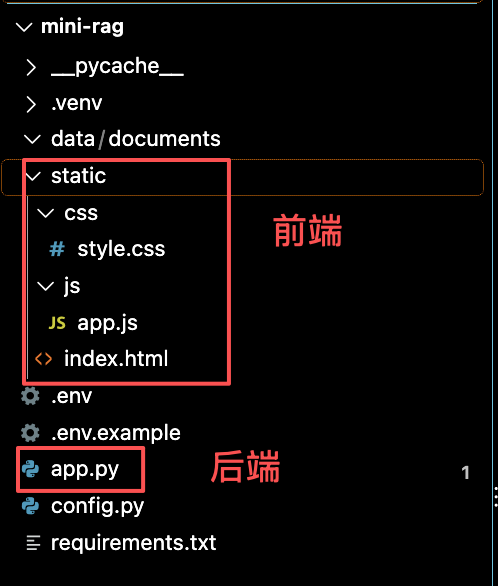
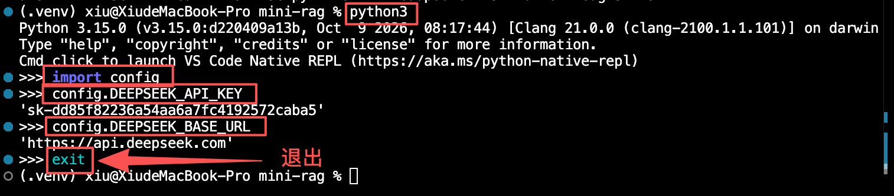
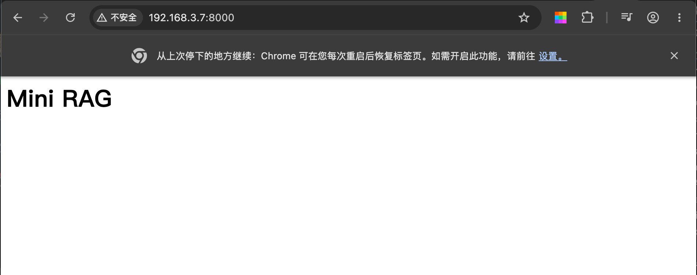
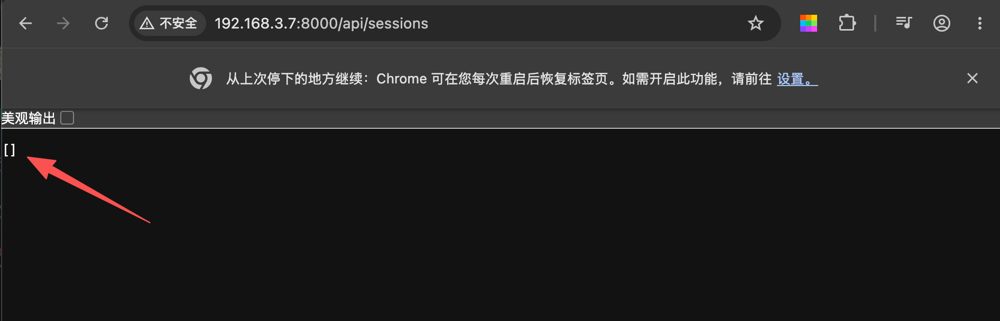

## flaks框架

### 1 创建静态目录结构

#### 1-1 先建好前端文件的目录

- 在mini-rag项目中创建静态文件夹static，用于存放前端的基本数据。

- 在static文件夹中创建index.html、css文件夹(创建style.css文件)、js文件夹（创建app.js文件）
  - `static`目录Flask会原样托管
  - 在`index.html`中写入
  
  ```html
  <h1>Mini RAG</h1>
  ```

#### 1-2 再创建后端文件

1-2-1 在mini-rag项目中创建app.py文件



1-2-2 编写后端文件app.py
  
```python
from flask import Flask, request, jsonify, send_from_directory

import config

app = Flask(__name__, static_folder='static', static_url_path='')

@app.route('/')
def index():
    return send_from_directory("static", "index.html")

@app.route('/api/sessions', methods=['GET'])
def list_sessions():
    # 会话功能
    return jsonify([])

@app.route('/api/documents', methods=['GET'])
def list_documents():
    # 文档功能
    return jsonify([])

if __name__ == '__main__':
    app.run(host="0.0.0.0", port=8000, debug=True)
```

**关键说明**：

- `Flask(__name__, static_folder='static', static_url_path='')`：把`static`目录挂到根路径，这样`css/style.css`、`js/app.js`会自动被托管，不需要手写路由
- `/api/session`和`/api/documents`：先返回空列表占位。虽然功能还没实现，但**路由的形态已经定下来**，前端后面按这个接口写，不会返工
- `debug=True`：改代码自动重启，方便开发

1-2-3 在终端运行

```js
python app.py
```

控制台输出



- 浏览器访问`http://192.168.3.7:8000`或`http://192.168.3.7:8000`或`http://localhost:8000`，能看到一个空白页面（static/index.html文件），说明静态托管生效



- 另开一个终端测试占位API

  - 浏览器访问`http://192.168.3.7:8000/api/sessions`或`http://192.168.3.7:8000/api/sessions`或`http://localhost:8000/api/sessions`
  - 浏览器访问`http://192.168.3.7:8000/api/documents`或`http://192.168.3.7:8000/api/documents`或`http://localhost:8000/api/documents`

都返回[]，说明路由响应正常


