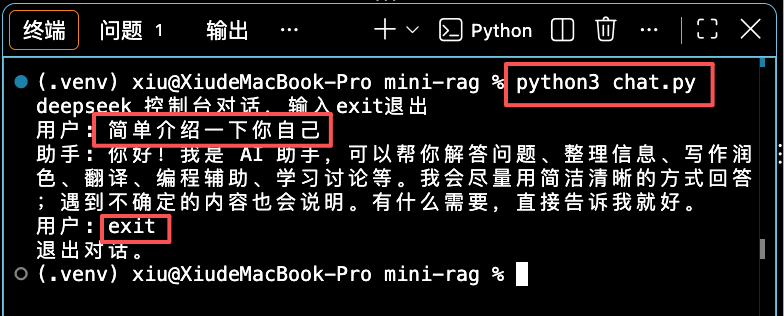

## 编写llm.py

### 下载openai依赖

在控制台运行

```js
pip install openai
```

在`mini-rag`文件夹下创建`llm.py`大模型，写入简单的发送接受请求

```python
import os
from openai import OpenAI

import config

# 创建全局
_client = None

def get_client():
    global _client
    if _client is None:
        key = config.DEEPSEEK_API_KEY
        if not key:
            raise ValueError("DEEPSEARCH_API_KEY 未配置，请先创建 .env 文件并设置 DEEPSEARCH_API_KEY")
        _client = OpenAI(api_key=key, base_url=config.DEEPSEEK_BASE_URL)
    return _client

# 对话方法
def chat_stream(messages):
    stream = get_client().chat.completions.create(
        model=config.DEEPSEEK_MODEL,
        messages=messages,
        stream=True,
        temperature=0.7,
        max_tokens=2048,
    )

    for chunk in stream:
        delta = chunk.choices[0].delta
        if delta.content:
            yield delta.content
```

在控制台运行`chat.py`

```js
python3 chat.py
```

在”用户：“后输入问题”简单介绍一下你自己“，会有回复，输入”exit“，会退出对话。


