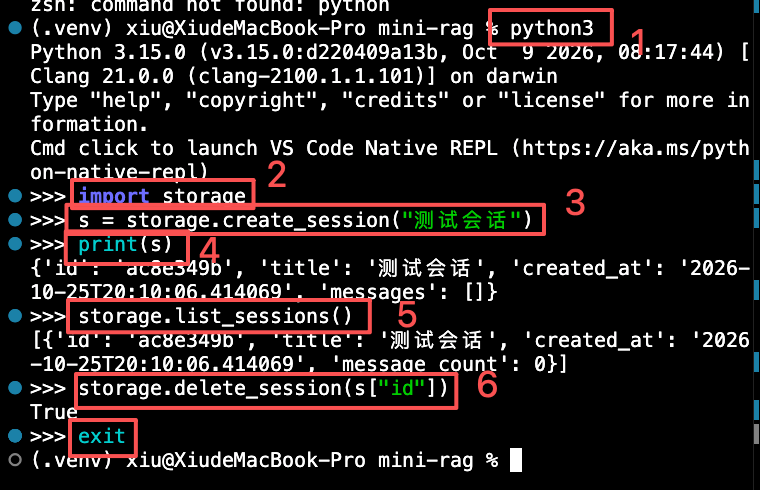
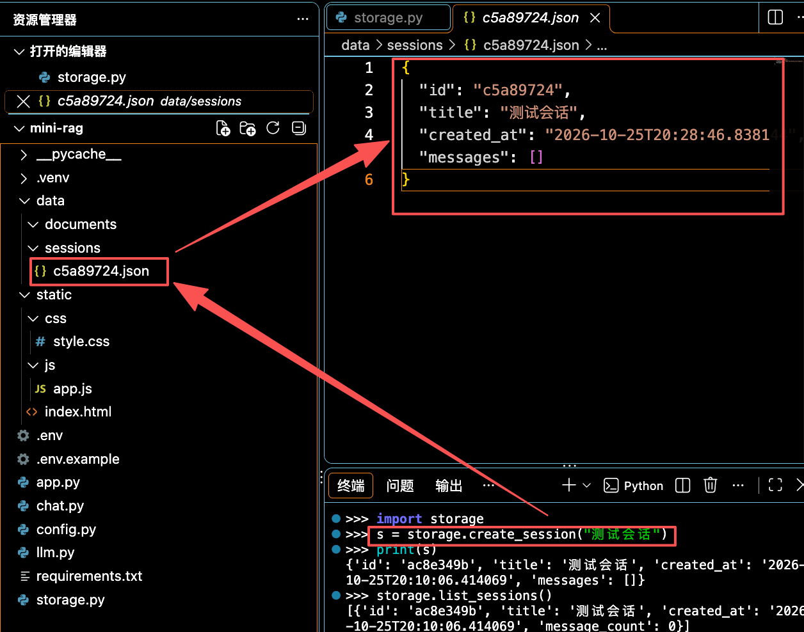

## 会话存储

在`mini-rag`文件夹中新建`storage.py`文件

```python
import json
import os
import uuid
from datetime import datetime
from config import DATA_DIR

# 设置会话记录保存的位置
SESSIONS_DIR = os.path.join(DATA_DIR, "sessions")
os.makedirs(SESSIONS_DIR, exist_ok=True)

# 读取JSON文件
def _load_json(path,default=None):
    if os.path.exists:
        with open(path, "r", encoding="utf-8") as f:
            return json.load(f)
    return default if default is not None else {}

# 写入JSON文件
def _save_json(path, data):
    with open(path, "w", encoding="utf-8") as f:
        json.dump(data, f, ensure_ascii=False, indent=2)

# 生成会话路径，下面的新建会话create_session需要用到
def get_session_path(session_id):
    return os.path.join(SESSIONS_DIR, f"{session_id}.json")

# 新建会话
def create_session(title=""):
    session_id = str(uuid.uuid4())[:8]
    session={
        "id": session_id,
        "title": title or f"会话 {session_id}",
        "created_at": datetime.now().isoformat(),
        "messages": []
    }
    # 保存
    _save_json(get_session_path(session_id), session)
    return session

# 读取单个会话
def get_session(session_id):
    path = get_session_path(session_id)
    if not os.path.exists(path):
        return None
    return _load_json(path)

# 更新会话
def save_session(session):
    _save_json(get_session_path(session["id"]), session)

# 列出所有会话
def list_sessions():
    sessions = []
    if not os.path.exists(SESSIONS_DIR):
        return sessions
    for fname in os.listdir(SESSIONS_DIR):
        if fname.endswith(".json"):
            s = _load_json(os.path.join(SESSIONS_DIR, fname))
            if s:
                sessions.append({
                    "id": s["id"],
                    "title": s["title"],
                    "created_at": s["created_at"],
                    "message_count": len(s.get("messages", [])),
                })
    # 根据会话时间，对当前的会话列表进行排序
    sessions.sort(key=lambda x: x["created_at"], reverse=True)
    return sessions

# 删除会话
def delete_session(session_id):
    path = get_session_path(session_id)
    if os.path.exists(path):
        os.remove(path)
        return True
    return False
```

## 设计要点

- **一个会话一个文件**：增删改查只需操作对应文件
- **消息格式**：messages是列表，每项`{role:"user", content:"..."}`，兼容OpenAI消息格式
- **自动标题**：create_session生成默认标题如”会话12345678“，后续发第一条消息时会用消息内容替换

## 运行效果

在项目根目录测试存储层

```js
// 1.运行python
python3
// 2.引入storage文件
import storage
// 3.创建测试会话，会在data/sessions文件夹下生成一个json文件
s = storage.create_session("测试会话")
// 4.打印json文件内容
print(s)
// 5.获取所有会话列表
storage.list_sessions()
// 6.删除会话
storage.delete_session(s["id"])
```




