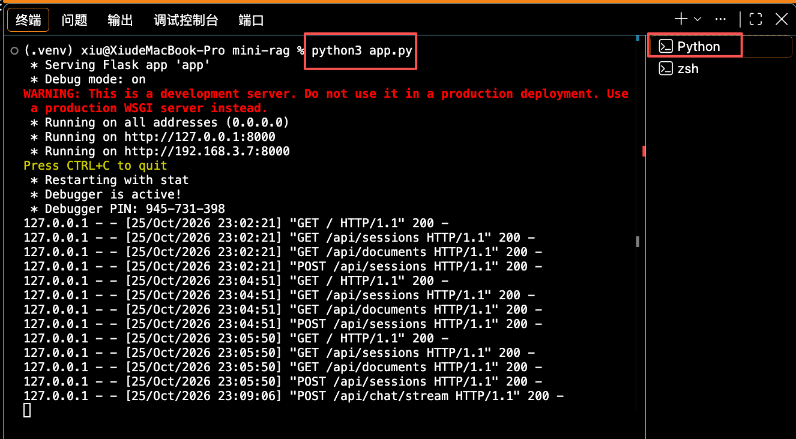
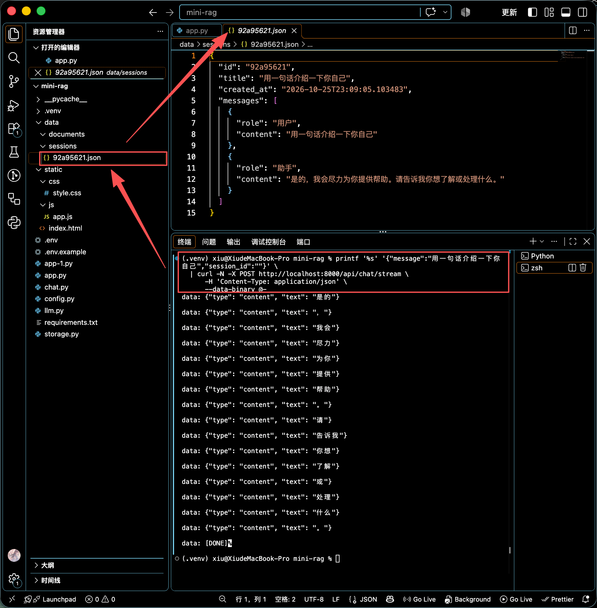
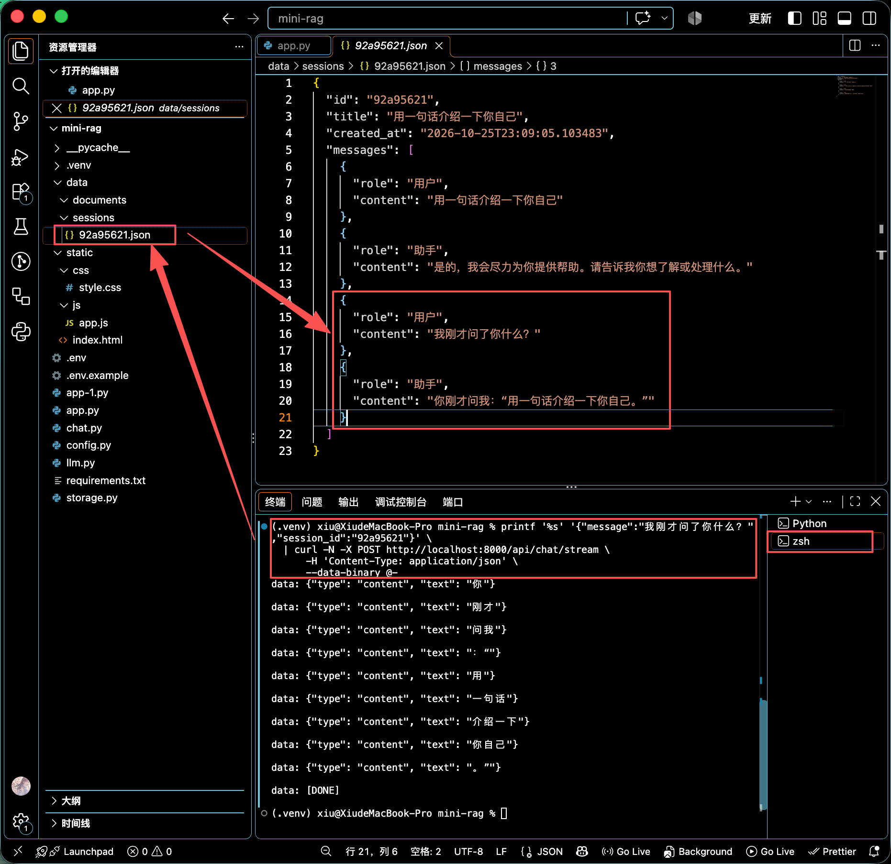

SSE(Server-Sent Events)是**服务器向浏览器单向推送文本**的协议，非常时候大模型流式输出。格式是若干行

```js
data: {"dype": "content", "text": "你"}

data: {"dype": "content", "text": "好"}

data: [DONE]
```

每行以`data:`开头，以空行(`\n\n`)分隔事件。前端按`\n\n`拆分、去掉前缀、解析JSON，就能逐token渲染。

## 聊天接口

把`app.py`补全为完整的对话服务：会话的4个REST接口+1个SSE聊天接口。

```python
from flask import Flask, request, jsonify, Response, send_from_directory

import json
import config
import llm
import storage

app = Flask(__name__, static_folder='static', static_url_path='')

@app.route('/')
def index():
    return send_from_directory("static", "index.html")

# 会话接口
@app.route('/api/sessions', methods=['GET'])
def list_sessions():
    # 会话功能
    return jsonify(storage.list_sessions())

# 创建新的会话消息
@app.route('/api/sessions', methods=['POST'])
def new_sessions():
    data = request.get_json(silent=True) or {}
    title = data.get("title", "").strip() or None
    # 调用创建会话方法 返回一个会话实例session
    session = storage.create_session(title)
    return jsonify(session)

# 获取一个单个会话的详细信息
@app.route('/api/sessions/<session_id>', methods=['GET'])
def get_session(session_id):
    s = storage.get_session(session_id)
    if not s:
        return jsonify({"error": "Session not found"}), 404
    return jsonify(s)

# 删除一个会话
@app.route('/api/sessions/<session_id>', methods=['DELETE'])
def delete_session(session_id):
    ok = storage.delete_session(session_id)
    if not ok:
        return jsonify({"error": "Session not found"}), 404
    return jsonify({"删除": True})

# —— —— 聊天接口（SSE流式）—— ——
def _stream_chat(history_messages, query):
    messages = [{"role": "system", "content": "你是一个有帮助的助手。"}]
    for m in history_messages:
        role = {"用户": "user", "助手": "assistant"}.get(m["role"], m["role"])
        messages.append({"role": role, "content": m["content"]})
    messages.append({"role": "user", "content": query})

    try:
        for token in llm.chat_stream(messages):
            payload = json.dumps({"type": "content", "text": token}, ensure_ascii=False)
            yield f"data: {payload}\n\n"
    except Exception as e:
        payload = json.dumps({"type": "error", "message": str(e)}, ensure_ascii=False)
        yield f"data: {payload}\n\n"
    yield "data: [DONE]\n\n"


@app.route('/api/chat/stream', methods=['POST'])
def chat_stream():
    data = request.get_json(force=True)
    # 获取用户输入的消息和会话ID
    query = data.get("message", "").strip()
    session_id = data.get("session_id", "").strip()

    # 如果没有当前会话
    if not query:
        # 返回空消息
        return jsonify({"error": "empty message"}), 400

    # 没传session_id 或 session不存在 → 自动创建
    if not session_id:
        s = storage.create_session()
        session_id = s["id"]
    elif not storage.get_session(session_id):
        s = storage.create_session()
        session_id = s["id"]

    # 内部方法：生成器
    def generate():
        session = storage.get_session(session_id)
        # 获取当前会话的历史消息
        history = session.get("messages", []) if session else []

        # 定义完整回复
        full_answer = ""
        failed = False

        # 详细处理SSE每一段消息
        for sse_line in _stream_chat(history, query):
            raw = sse_line.removeprefix("data: ").strip()
            if raw and raw != "[DONE]":
                event = json.loads(raw)
                if event.get("type") == "content":
                    full_answer += event.get("text", "")
                elif event.get("type") == "error":
                    failed = True
            yield sse_line

        if failed or not session:
            return

        # 将会话追踪到消息列表中
        session["messages"].append({"role": "用户", "content": query})
        session["messages"].append({"role": "助手", "content": full_answer})

        if not session.get("title") or session["title"].startswith("会话 "):
            # 将会话的前30个字符作为标题使用,如果超过30个字符就用...代替
            session["title"] = query[:30]+("..." if len(query)>30 else "")
        # 最终会话存储到消息列表中
        storage.save_session(session)

    # 返回响应
    return Response(
        generate(),
        mimetype="text/event-stream",
        headers={
            "Cache-Control": "no-cache",
            "Connection": "keep-alive",
            "X-Accel-Buffering": "no",
        },
    )

@app.route('/api/documents', methods=['GET'])
def list_documents():
    # 文档功能
    return jsonify([])

if __name__ == '__main__':
    app.run(host="0.0.0.0", port=8000, debug=True)
```

## 测试

首先确保依赖是否都安装了

```js
// 安装requirements.txt文件中的依赖
.venv/bin/python -m pip install -r requirements.txt
// 安装flask
.venv/bin/python -m pip install Flask
```

### 运行效果

启动服务（一个终端）

```js
python app.py
```



打开另一个终端，测试流式接口

window系统运行

```cmd
$outputEncoding = [System.Text.Encoding]::UTF8
'{"message": "用一句话介绍一下你自己", "session_id": ""}' | curl.exe -N -X POST http://localhost:8000/api/chat/stream -H "Content-Type: application/json" --data-binary "@-"
```

mac本运行

```cmd
printf '%s' '{"message":"用一句话介绍一下你自己","session_id":""}' \
  | curl -N -X POST http://localhost:8000/api/chat/stream \
      -H 'Content-Type: application/json' \
      --data-binary @-
```



控制台前端接口流式输出，同时data/sessions文件夹下创建了新的json文件，测试成功。

### 第二次对话（把session_id 换成上一步生成的）

window系统运行

```cmd
$outputEncoding = [System.Text.Encoding]::UTF8
'{"message": "我刚才问了你什么？", "session_id": "92a95621"}' | curl.exe -N -X POST http://localhost:8000/api/chat/stream -H "Content-Type: application/json" --data-binary "@-"
```

mac本运行

```cmd
printf '%s' '{"message":"我刚才问了你什么？","session_id":"92a95621"}' \
  | curl -N -X POST http://localhost:8000/api/chat/stream \
      -H 'Content-Type: application/json' \
      --data-binary @-
```



控制台前端接口流式输出，同时data/sessions文件夹下的json文件中的messages字段新增对话内容，测试成功。
