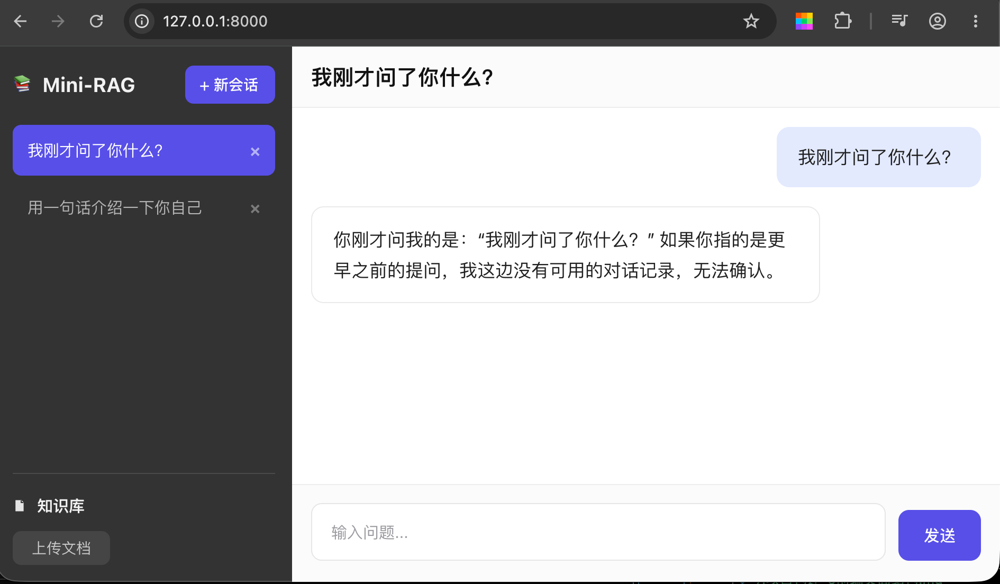

## 页面骨架

static/index.html文件

```js
<!DOCTYPE html>
<html lang="zh-CN">
<head>
  <meta charset="UTF-8" />
  <meta name="viewport" content="width=device-width, initial-scale=1" />
  <title>Mini-RAG · 知识库问答</title>
  <link rel="stylesheet" href="./css/style.css" />
</head>
<body>
  <div class="app">

    <!-- ============ 左侧栏 ============ -->
    <aside class="sidebar">
      <div class="sidebar__head">
        <div class="brand">
          <span class="brand__logo" aria-hidden="true">📚</span>
          <h1 class="brand__name">Mini-RAG</h1>
        </div>
        <button id="btn-new-session" class="btn btn--primary btn--new" type="button">
          <span class="btn__plus" aria-hidden="true">+</span>新会话
        </button>
      </div>

      <!-- 会话列表：静态占位，接入后端后由 JS 渲染 -->
      <ul id="session-list" class="session-list" aria-label="会话列表">
        <!-- <li class="session-item is-active">
          <button class="session-item__main" type="button">会话dac3b1f9</button>
          <button class="session-item__close" type="button" aria-label="删除该会话">×</button>
        </li> -->

        <!-- 更多会话示例
        <div class="session-item">
          <button class="session-item__main" type="button">会话 8f2c1a04</button>
          <button class="session-item__close" type="button" aria-label="删除该会话">×</button>
        </div>
        -->
      </ul>

      <div class="sidebar__foot">
        <div class="divider" role="presentation"></div>

        <h2 class="kb-title">
          <svg class="kb-title__icon" viewBox="0 0 16 16" aria-hidden="true">
            <path d="M2.8 2.4h6.1l2.1 2.1v9.1H2.8z" fill="currentColor" opacity=".92"/>
            <path d="M8.6 2.6v2.2h2.2" fill="none" stroke="#333333" stroke-width="1.1"/>
          </svg>
          知识库
        </h2>

        <button class="btn btn--ghost" type="button">上传文档</button>
      </div>
    </aside>

    <!-- ============ 主区域 ============ -->
    <main class="main">
      <header class="topbar">
        <h2 id="current-session-title" class="topbar__title">会话dac3b1f9</h2>
      </header>

      <div class="chat" id="chat">
        <div class="msg msg--user">
          <div class="msg__bubble">你好，用一句话介绍你自己</div>
        </div>

        <div class="msg msg--ai">
          <div class="msg__bubble">
            你好，我是DeepSeek，一个由深度求索公司创造的AI助手，乐于帮你解答各种问题！
          </div>
        </div>

        <div class="msg msg--user">
          <div class="msg__bubble">我刚才问了你什么？</div>
        </div>

        <div class="msg msg--ai">
          <div class="msg__bubble">你刚才问的是："你好，用一句话介绍你自己。"</div>
        </div>

        <!-- 空状态（无会话时显示，去掉 hidden 即可）
        <div class="empty-state">
          <div class="empty-state__mark" aria-hidden="true">
            <svg viewBox="0 0 24 24">
              <path d="M4 5.5h16v10.2H9.6L5.4 19v-3.3H4z" fill="none" stroke="currentColor"
                    stroke-width="1.4" stroke-linejoin="round"/>
            </svg>
          </div>
          <p class="empty-state__text">选择一个会话，或点击「新会话」开始提问</p>
        </div>
        -->
      </div>

      <footer class="composer">
        <form class="composer__inner" action="#" method="post">
          <textarea
            id="user-input"
            class="composer__input"
            name="question"
            rows="1"
            placeholder="输入问题..."
            aria-label="输入问题"
          ></textarea>
          <button id="btn-send" class="btn btn--send" type="submit">发送</button>
        </form>
      </footer>
    </main>

  </div>
</body>
</html>
<script src="./js/app.js"></script>
```

static/css/style.css文件

```css
/* =========================================================
   Mini-RAG · 类 DeepSeek 网页版静态样式
   仅 index.html + style.css，无 JS、无外部依赖
   ========================================================= */

/* ---------- 设计变量 ---------- */
:root {
  /* 侧栏（深色） */
  --sidebar-bg: #333333;
  --sidebar-bg-hover: #3d3d3d;
  --sidebar-bg-btn: #454545;
  --sidebar-bg-btn-hover: #525252;
  --sidebar-line: #4a4a4a;
  --sidebar-text: #f2f2f2;
  --sidebar-text-muted: #b4b4b4;

  /* 主区域 */
  --bg: #ffffff;          /* 会话区 */
  --bg-bar: #fbfbfb;      /* 顶栏 / 输入区 */
  --text: #1f1f1f;
  --text-muted: #8c8c8c;
  --border: #ededed;
  --border-strong: #e6e6e6;

  /* 主色 */
  --accent: #584fe8;
  --accent-hover: #4a41d8;
  --bubble-user: #e3eafe;   /* 用户气泡 */
  --bubble-ai-border: #eaeaea;

  /* 尺寸 */
  --sidebar-w: 340px;
  --topbar-h: 58px;
  --radius-sm: 8px;
  --radius-md: 10px;
  --radius-bubble: 12px;

  /* 字体 */
  --font-sans: -apple-system, BlinkMacSystemFont, "Segoe UI", "PingFang SC",
    "Hiragino Sans GB", "Microsoft YaHei", "Helvetica Neue", Arial, sans-serif;
}

/* ---------- 基础重置 ---------- */
*,
*::before,
*::after {
  box-sizing: border-box;
}

html,
body {
  height: 100%;
}

body {
  margin: 0;
  font-family: var(--font-sans);
  font-size: 15px;
  line-height: 1.6;
  color: var(--text);
  background: var(--bg);
  -webkit-font-smoothing: antialiased;
  text-rendering: optimizeLegibility;
}

button,
textarea {
  font: inherit;
  color: inherit;
}

h1,
h2,
p {
  margin: 0;
}

/* 保证 hidden 属性优先于 .empty-state 等 display:flex 规则 */
[hidden] {
  display: none !important;
}

/* ---------- 整体骨架 ---------- */
.app {
  display: flex;
  height: 100vh;
  height: 100dvh;
  overflow: hidden;
}

/* =========================================================
   左侧栏
   ========================================================= */
.sidebar {
  display: flex;
  flex-direction: column;
  flex: 0 0 var(--sidebar-w);
  width: var(--sidebar-w);
  padding: 22px 20px 20px;
  background: var(--sidebar-bg);
  color: var(--sidebar-text);
}

/* 顶部：品牌 + 新会话 */
.sidebar__head {
  display: flex;
  align-items: center;
  justify-content: space-between;
  gap: 12px;
}

.brand {
  display: flex;
  align-items: center;
  gap: 10px;
  min-width: 0;
}

.brand__logo {
  font-size: 18px;
  line-height: 1;
}

.brand__name {
  font-size: 19px;
  font-weight: 700;
  letter-spacing: 0.2px;
  white-space: nowrap;
}

/* 会话列表区 */
.session-list {
  flex: 1 1 auto;
  min-height: 0;
  margin: 20px -4px 0;
  padding: 0 4px;
  overflow-y: auto;
  overscroll-behavior: contain;
}

.session-item {
  display: flex;
  align-items: center;
  gap: 6px;
  height: 48px;
  padding: 0 8px 0 14px;
  margin-bottom: 6px;
  border-radius: var(--radius-sm);
  color: var(--sidebar-text-muted);
  transition: background-color 0.15s ease, color 0.15s ease;
}

.session-item:hover {
  background: var(--sidebar-bg-hover);
  color: var(--sidebar-text);
}

/* 当前选中的会话：实心紫底 */
.session-item.is-active {
  background: var(--accent);
  color: #fff;
}

.session-item__main {
  flex: 1 1 auto;
  min-width: 0;
  padding: 0;
  border: 0;
  background: none;
  font-size: 16px;
  text-align: left;
  white-space: nowrap;
  overflow: hidden;
  text-overflow: ellipsis;
  cursor: pointer;
  color: inherit;
}

.session-item__close {
  flex: 0 0 auto;
  display: flex;
  align-items: center;
  justify-content: center;
  width: 22px;
  height: 22px;
  padding: 0;
  border: 0;
  border-radius: 5px;
  background: none;
  color: currentColor;
  opacity: 0.55;
  font-size: 16px;
  line-height: 1;
  cursor: pointer;
  transition: opacity 0.15s ease, background-color 0.15s ease;
}

.session-item__close:hover {
  opacity: 1;
  background: rgba(255, 255, 255, 0.16);
}

.session-item__close:focus-visible {
  outline: 2px solid #fff;
  outline-offset: 1px;
}

/* 底部：知识库 */
.sidebar__foot {
  flex: 0 0 auto;
  padding-top: 4px;
}

.divider {
  height: 1px;
  margin-bottom: 18px;
  background: var(--sidebar-line);
}

.kb-title {
  display: flex;
  align-items: center;
  gap: 8px;
  margin-bottom: 12px;
  font-size: 15px;
  font-weight: 600;
  color: var(--sidebar-text);
}

.kb-title__icon {
  width: 15px;
  height: 15px;
  flex: 0 0 auto;
}

/* =========================================================
   按钮
   ========================================================= */
.btn {
  display: inline-flex;
  align-items: center;
  justify-content: center;
  gap: 4px;
  border: 0;
  border-radius: var(--radius-sm);
  font-size: 14px;
  font-weight: 500;
  line-height: 1;
  cursor: pointer;
  white-space: nowrap;
  transition: background-color 0.16s ease, color 0.16s ease,
    box-shadow 0.16s ease, transform 0.06s ease;
}

.btn:active {
  transform: translateY(0.5px);
}

.btn:focus-visible {
  outline: 2px solid var(--accent);
  outline-offset: 2px;
}

/* 主按钮：新会话 */
.btn--primary {
  padding: 10px 16px 10px 13px;
  background: var(--accent);
  color: #fff;
}

.btn--primary:hover {
  background: var(--accent-hover);
}

.btn__plus {
  font-size: 16px;
  font-weight: 400;
  line-height: 1;
}

/* 次级按钮：上传文档 */
.btn--ghost {
  align-self: flex-start;
  padding: 9px 18px;
  background: var(--sidebar-bg-btn);
  color: #c9c9c9;
  font-weight: 400;
}

.btn--ghost:hover {
  background: var(--sidebar-bg-btn-hover);
  color: #fff;
}

/* 发送按钮 */
.btn--send {
  flex: 0 0 auto;
  width: 78px;
  height: 48px;
  padding: 0;
  border-radius: var(--radius-md);
  background: var(--accent);
  color: #fff;
  font-size: 15px;
}

.btn--send:hover {
  background: var(--accent-hover);
}

/* =========================================================
   主区域
   ========================================================= */
.main {
  display: flex;
  flex: 1 1 auto;
  flex-direction: column;
  min-width: 0;
  background: var(--bg);
}

/* 顶部标题栏 */
.topbar {
  display: flex;
  flex: 0 0 var(--topbar-h);
  align-items: center;
  height: var(--topbar-h);
  padding: 0 24px;
  border-bottom: 1px solid var(--border);
  background: var(--bg-bar);
}

.topbar__title {
  overflow: hidden;
  font-size: 20px;
  font-weight: 600;
  letter-spacing: 0.2px;
  color: #111;
  white-space: nowrap;
  text-overflow: ellipsis;
}

/* ---------- 对话区 ---------- */
.chat {
  display: flex;
  flex: 1 1 auto;
  flex-direction: column;
  gap: 18px;
  min-height: 0;
  padding: 22px 24px;
  overflow-y: auto;
  overscroll-behavior: contain;
}

/* 单条消息：占满整行，气泡各自贴边 */
.msg {
  display: flex;
  width: 100%;
}

.msg--user {
  justify-content: flex-end;
}

.msg__bubble {
  max-width: 76%;
  font-size: 17px;
  line-height: 1.7;
  color: var(--text);
  word-break: break-word;
  overflow-wrap: break-word;
}

.msg__bubble p + p {
  margin-top: 10px;
}

/* 用户气泡：浅紫底、无描边 */
.msg--user .msg__bubble {
  padding: 14px 20px;
  border-radius: var(--radius-bubble);
  background: var(--bubble-user);
}

/* AI 气泡：白底 + 细描边，左上角为直角感（无头像） */
.msg--ai .msg__bubble {
  padding: 16px 20px;
  border: 1px solid var(--bubble-ai-border);
  border-radius: var(--radius-bubble);
  background: #fff;
}

/* 空状态（无会话时） */
.empty-state {
  display: flex;
  flex: 1 1 auto;
  flex-direction: column;
  align-items: center;
  justify-content: center;
  gap: 14px;
  color: var(--text-muted);
}

.empty-state__mark {
  display: flex;
  align-items: center;
  justify-content: center;
  width: 46px;
  height: 46px;
  border-radius: 14px;
  background: #f6f6f7;
  color: #b9b9bd;
}

.empty-state__mark svg {
  width: 22px;
  height: 22px;
}

.empty-state__text {
  font-size: 14px;
  color: #a8a8ad;
}

/* =========================================================
   底部输入区
   ========================================================= */
.composer {
  flex: 0 0 auto;
  padding: 17px 24px 20px;
  border-top: 1px solid var(--border);
  background: var(--bg-bar);
}

.composer__inner {
  display: flex;
  align-items: flex-end;
  gap: 12px;
}

.composer__input {
  flex: 1 1 0;
  width: auto;
  min-width: 0; /* 窄屏下不把发送按钮挤出容器 */
  min-height: 54px;
  max-height: 200px;
  padding: 15px 18px;
  border: 1px solid var(--border-strong);
  border-radius: var(--radius-md);
  background: #fff;
  font-size: 15px;
  line-height: 1.5;
  color: var(--text);
  resize: none;
  overflow-y: auto;
  outline: none;
  field-sizing: content; /* 随内容自动增高，不支持的浏览器自动降级 */
  transition: border-color 0.15s ease, box-shadow 0.15s ease;
}

.composer__input::placeholder {
  color: #9b9ba0;
}

.composer__input:hover {
  border-color: #d6d6d8;
}

.composer__input:focus {
  border-color: var(--accent);
  box-shadow: 0 0 0 3px rgba(88, 79, 232, 0.12);
}

/* 细滚动条 */
.session-list::-webkit-scrollbar,
.chat::-webkit-scrollbar,
.composer__input::-webkit-scrollbar {
  width: 6px;
}

.session-list::-webkit-scrollbar-thumb,
.chat::-webkit-scrollbar-thumb,
.composer__input::-webkit-scrollbar-thumb {
  border-radius: 3px;
  background: rgba(140, 140, 140, 0.35);
}

.session-list::-webkit-scrollbar-thumb {
  background: rgba(255, 255, 255, 0.22);
}

.session-list::-webkit-scrollbar-track,
.chat::-webkit-scrollbar-track,
.composer__input::-webkit-scrollbar-track {
  background: transparent;
}

/* =========================================================
   响应式
   ========================================================= */
@media (max-width: 1000px) {
  :root {
    --sidebar-w: 280px;
  }

  .sidebar {
    padding: 18px 16px 16px;
  }

  .topbar,
  .composer {
    padding-left: 18px;
    padding-right: 18px;
  }

  .chat {
    padding: 18px;
  }
}

@media (max-width: 720px) {
  .sidebar {
    display: none;
  }

  .topbar {
    padding: 0 16px;
  }

  .topbar__title {
    font-size: 17px;
  }

  .chat {
    padding: 16px;
    gap: 14px;
  }

  .msg__bubble {
    max-width: 88%;
    font-size: 15px;
  }

  .composer {
    padding: 12px 16px 16px;
  }

  .btn--send {
    width: 68px;
    height: 46px;
  }
}

@media (prefers-reduced-motion: reduce) {
  * {
    transition: none !important;
  }
}
```

运行app.py，在浏览器打开地址


