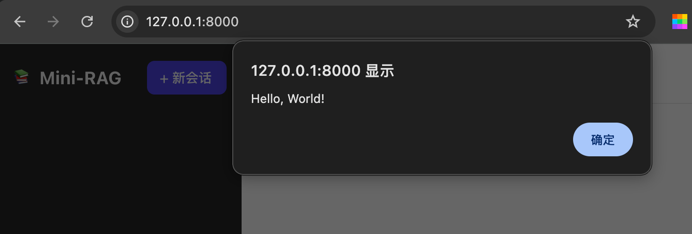

## 整体设计

全部代码放在一个IIFE中，避免污染全局变量。
按职责分块：`工具函数与全局状态 → 会话管理 → 聊天（SSE流式） → 事件绑定与初始化`

### 测试代码

在static/js文件夹下创建`app.js`文件，写入以下代码

```js
alert("Hello, World!");
```

运行app.py，在浏览器打开地址，有弹框，表示代码运行成功



### 关键说明

`app.js`文件代码

```js
(
    function() {
        const API = "/api"

        let state = {
            session: [],
            activeSessionId: null,
            streamingAbort: null,
        };
        const $ = (sel) => document.querySelector(sel);
        const sessionList = $("#session-list");
        const messagesEl = $("#chat");
        const userInput = $("#user-input");
        const btnSend = $("#btn-send");
        const btnNew = $("#btn-new-session");
        const sessionTitle = $("#current-session-title");

        /**
         * api请求方法
         * @param {*} method 方法
         * @param {*} path 路径
         * @param {*} body 请求体
         * @returns 
         */
        async function api(method, path, body) {
            const opts = { method, headers: { "Content-Type": "application/json" } };
            if (body) opts.body = JSON.stringify(body);
            // 原生fetch请求向后端发送请求
            const res = await fetch(API + path, opts);
            return await res.json();
        }
    }
)()
```

- `state`：全局状态对象，根据当前活跃会话和流式请求的AbortController
- `api()`：统一的JSON请求函数，自动设置Content-Type和序列化body
- 这里只取聊天需要的DOM元素；文档区元素加知识库功能时再取

### 会话管理逻辑说明

```js
// —— —— 会话管理 —— ——
// 加载会话
async function loadSessions() {
    // 接收在会话列表中获取后台所有会话数据
    state.session = await api("GET", "/sessions");
    // 刷新会话列表
    await renderSessions();
}
// 刷新会话列表
function renderSessions() {
    sessionList.innerHTML = "";
    state.session.forEach(s => {
        const li = document.createElement("div");
        li.className = "session-item";
        li.dataset.id = s.id;
        if (s.id === state.activeSessionId) li.classList.add("is-active");

        const span = document.createElement("span");
        span.textContent = s.title || "未命名";
        span.style.flex = 1;
        
        span.addEventListener("click", () => {
            switchSession(s.id);
        });
        const del = document.createElement("b");
        del.className = "session-item__close";
        del.textContent = "×";
        del.addEventListener("click", (e) => {
            e.stopPropagation();
            deleteSession(s.id);
        });

        li.appendChild(span);
        li.appendChild(del);
        sessionList.appendChild(li);
    });
}

// 切换会话按钮
async function switchSession(id) {
    console.log(state, 'state')
    state.activeSessionId = id;
    // 根据会话id获取会话数据
    const sess = await api("GET", `/sessions/${id}`);
    console.log(sess, 'sess')
    messagesEl.innerHTML = "";
    if (sess && sess.messages) {
        sess.messages.forEach(msg => addMessage(msg.role, msg.content));
        sessionTitle.textContent = sess ? sess.title : "Mini-RAG";
        scrollBottom();
        btnSend.disabled = false;
        renderSessions();
    }
}

// 删除会话按钮
async function deleteSession(id) {
    await api("DELETE", `/sessions/${id}`);
    if (state.activeSessionId === id) {
        state.activeSessionId = null;
        messagesEl.innerHTML = "";
        sessionTitle.textContent = "选择一个会话";
        btnSend.disabled = true;
    }
    await loadSessions();
}
```

- `switchSession`：点击会话 → 请求后端拿完整消息列表 → 清空消息区 → 逐条`addMessage`重建DOM。这样即使刷新页面，历史消息也能完整恢复
- `deleteSession`：删除后如果正好是当前会话，清空聊天区并禁用发送按钮
- `renderSessions`：用`createElement`动态构建DOM，而非`innerHTML`拼接字符串————后者在列表项多时会很慢

### 消息渲染辅助函数

```js
// —— —— 消息渲染辅助函数 —— ——
function addMessage(role, content, idHint) {
    const div = document.createElement("div");
    div.className = `msg ${role}`;
    const divContent = document.createElement("div");
    divContent.className = "msg__bubble";
    if (idHint) divContent.id = idHint;
    divContent.textContent = content;
    div.appendChild(divContent);
    messagesEl.appendChild(div);
    scrollBottom();
    return div;
}
function scrollBottom() {
    messagesEl.scrollTop = messagesEl.scrollHeight;
}
```

`switchSession`里用到了`addMessage`和`scrollBottom`两个函数

- `addMessage`：往消息区追加一条消息气泡。`role`取`user`或`assistant`，对应CSS里靠右/靠左的样式；`idHint`用于后面流式聊天时给“思考中...”气泡一个临时id，方便定位
- `scrollBottom`：把消息区滚动条滚到底部，保证最新消息可见。会话切换、发送消息时都会用到

### 事件绑定与初始化

```js
// —— —— 事件绑定与初始化 —— ——
btnNew.addEventListener("click", async () => {
    const sess = await api("POST", "/sessions");
    state.activeSessionId = sess.id;
    messagesEl.innerHTML = "";
    sessionTitle.textContent = sess.title || "Mini-RAG";
    btnSend.disabled = false;
    // 异步刷新
    await loadSessions();
});
// 初始加载
async function init() {
    // 刷新会话列表
    await loadSessions();
}

init();
```

最后把“新会话”按钮接上，并在页面加载时拉取会话列表

- 新建会话流程：点击“新会话”按钮 → `POST/sessions`让后端创建会话 → 把返回的`id`设为当前活跃会话
